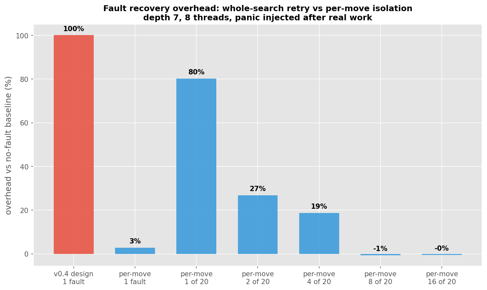

# Fault Tolerance: Per-Move Recovery

**v0.6.0** | June 2026 | Apple M1 Pro, depth 7, 8 threads

The v0.4.0 design wrapped the whole parallel search in one `catch_unwind`. Any thread panicking
meant rayon threw away every thread's finished work and the wrapper re-ran the entire search:
one fault cost 100% overhead, same as running the search twice. The v0.4 docs set a target of
getting that under 30%. This is that work.

## The rework

Each root move runs inside its own `catch_unwind`, so a crashing move loses only its own
subtree. Finished results are kept per index (`CompletedMoves`) and never recomputed. Only the
failed moves retry - as a parallel batch, up to 2 rounds - and a move that keeps dying gets
dropped and logged, with the search returning the best of the rest flagged `degraded` instead of
crashing.

Fault injection targets moves by stable index (`InjectionPlan`) instead of the old global
counter, so K simultaneous faults are reproducible.

## The seed problem

First measurements looked great for an ordinary fault (+3%) and terrible for one specific case:
a fault hitting the *seed move* cost ~226%. The seed is the move searched first to give everyone
else a pruning bound - lose it and the whole batch silently runs near-full-window at ~3x. The
recovery design had a single point of failure for performance, just not for correctness.

Two fixes:

1. **Re-seed with the shallow runner-up.** The seed-picking search now keeps its second-best
   move, and a crashed seed falls back to it. Necessary but not sufficient - at the start
   position the best move's score is an outlier (100 vs the runner-up's 10), and a 10-bound
   barely prunes.
2. **Tighten the bound between chunks.** Each retry round now runs in index-ordered chunks of
   one pool's worth of moves, and the bound is re-raised from completed scores after each chunk.
   So even a weak starting bound recovers as soon as one good chunk finishes. I tried the
   tempting version first - a live shared bound that tightens continuously - and it was faster
   but made tie-breaks depend on thread timing, which broke the serial==parallel determinism
   tests within seconds. Chunked tightening keeps every score timing-independent.

## Results

`--fault-analysis`, overhead vs the no-wrapper baseline:

| scenario | faults (of 20 moves) | overhead |
|----------|----------------------|----------|
| v0.4 whole-search retry | 1 | 100% |
| per-move, ordinary fault | 1 | +3% |
| per-move, seed faulted | 1 | +80% |
| per-move, seed + runner-up faulted | 2 | +27% |
| per-move | 4 | +19% |
| per-move | 8 | -1% |
| per-move | 16 | -0% |



Reading that table honestly:

- The common case (a fault on a non-seed move) is basically free: +3%, and the isolation
  itself costs ~2% when nothing fails.
- A fault on the seed still costs +80% - that's close to the floor, since the best move's
  search has to be redone and it dominates the runtime anyway.
- The "more faults = cheaper" tail isn't a typo. Mass faults knock out the serial seed phase
  entirely, and everything - including the best move - gets searched in one parallel batch.
  Which quietly reveals where this engine's latency actually lives: in the serial seed search,
  not the batch.

Correctness holds in every scenario (same move and score as baseline, `Correctness: PASS`), and
the suite's recovery tests fault all 20 moves at once and still assert agreement with serial
search.

## Reproduction

```bash
./target/release/devi --fault-analysis --depth 7 --threads 8
# writes benchmarks/fault_overhead.csv
```
