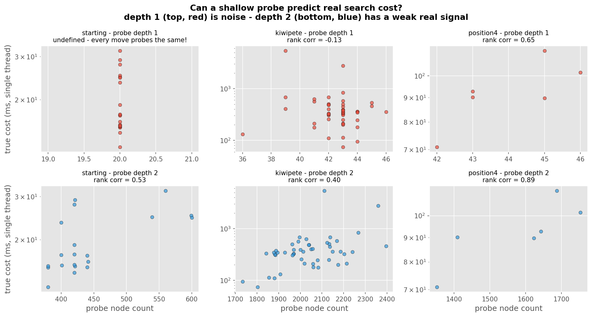
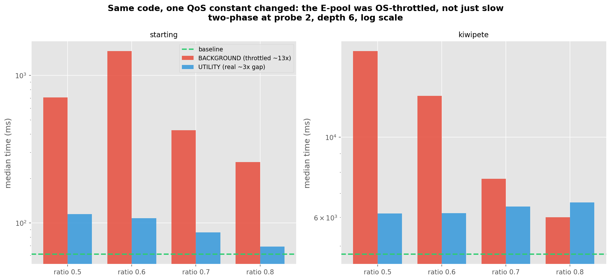
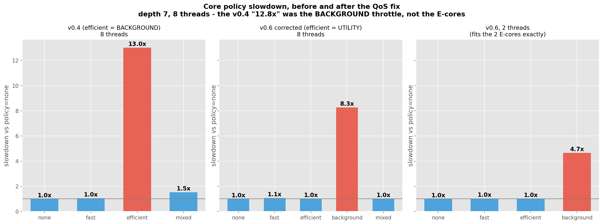
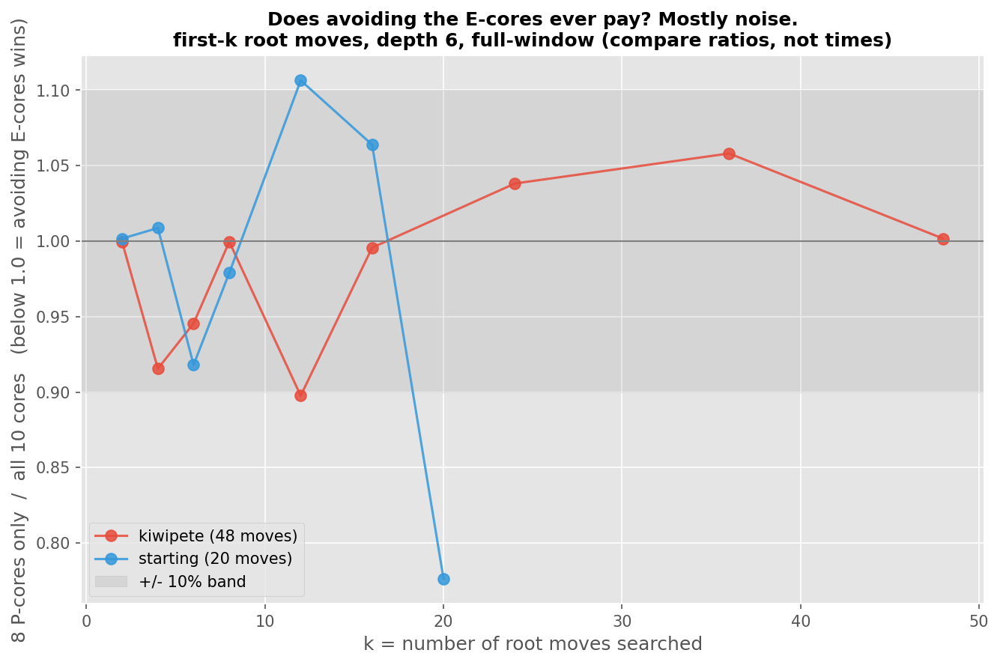

# Two-Phase Scheduler: Reality Check

**v0.6.0** | June 2026 | Apple M1 Pro (8P + 2E), depth 6

Before pitching this project I went back and re-verified the v0.5.0 claims in
[two_phase_summary.md](../v0.5.0/two_phase_summary.md) and
[two_phase_detailed.md](../v0.5.0/two_phase_detailed.md). [v0.5.1](../v0.5.1/two_phase_recheck.md)
already caught the first half - a sign bug in the search was the whole 1.55x, and fixing it flips
two-phase to a loss, with the phase-2 blowup pointing at the E-cores. This doc finishes the job:
the scheduler/QoS half, and whether routing can win once that's accounted for. Short version: it can't.

The original idea was really two claims: (1) you can cheaply predict which root moves are heavy,
(2) routing on that prediction beats doing nothing. They got different answers.

---

## Can the probe predict heavy moves?

`--classify-analysis` measures this with no scheduler in the loop: probe node count per root move
vs true cost (median single-thread time of a full-depth search of that move). Rank correlation
between the two orderings, 1.0 = perfect, 0 = no relationship:

| position | moves | probe@1 | probe@2 | probe@3 |
|----------|-------|---------|---------|---------|
| starting | 20 | 0.00 | 0.53 | 0.41 |
| kiwipete | 48 | -0.13 | 0.40 | 0.29 |
| position4 | 6 | 0.65 | 0.89 | 0.77 |



Probe depth 1 - the default I shipped - is noise. At depth 1 the probe just counts the opponent's
replies, which is basically the same for every move (startpos: exactly 20 for all of them).
Depth 2 is the sweet spot: its heavy set captures 66-74% of the real work on starting/kiwipete vs
~58-60% picking randomly. Depth 3 predicts worse and costs 30-70x more (kiwipete: 8.6ms -> 578ms
of probe time), because raw node count measures tree width, not pruned search cost.

Fix: probe default is now 2.

---

## Where the 1.55x came from

The v0.5.0 baseline searched every root move full-window in parallel. No shared pruning bound, no
seeding. Slow. Phase 2 handed the E-cores phase 1's best score as a pruning bound - but the
implementation negated a white-relative alphabeta as if it were negamax, with a hardcoded
side-to-move flag. It was fast because it pruned subtrees it had no right to prune, and it could
pick wrong moves.

So the old doc's "Key Insight" (the alpha-bound handoff) was describing a bug. v0.5.1 fixed move
selection and removed the handoff (`690df81`) and gave the baseline seeding plus a sound shared
bound (`b3d9510`). Two-phase got slower-but-correct, the baseline got faster, and the 1.55x flipped
to a loss.

---

## Does routing pay after the fixes?

Three fixes on this branch:

1. probe 1 -> 2
2. the phases overlap now (`thread::scope`) - they used to run back to back, waiting on an alpha
   handoff that no longer existed. kiwipete at ratio 0.8: 37.2s -> 25.9s
3. the E-pool used `QOS_CLASS_BACKGROUND`, macOS's "user must never notice" tier, ~13x slowdown.
   `QOS_CLASS_UTILITY` runs E-cores at their real ~3x gap. kiwipete with 40% of moves on E:
   13008ms -> 6157ms from that one constant. This also explains v0.4.0's "12.8x P/E gap" - that
   experiment used BACKGROUND too, so it measured the throttle, not the silicon.


After all three fixes (depth 6, 12 runs, median, `charitable_utility.csv`):

| position | baseline (10 threads) | best two-phase | config |
|----------|----------------------|----------------|--------|
| starting | 61.2ms | 69.0ms (0.89x) | probe@2, ratio 0.8 |
| kiwipete | 4743ms | 6146ms (0.77x) | probe@2, ratio 0.5 |
| position4 | 174ms | 121ms (1.43x) | probe@2, ratio 0.8 |

position4's 1.43x isn't a scheduler win - its phase-2 time is zero, the E-cores never run. The
baseline loses there because it seeds one move serially before going parallel (Young Brothers
Wait), which hurts with only 6 similar-cost moves. FastBias alone is 0.97-1.00x of baseline,
since foreground work lands on P-cores anyway. The 0.12-0.21x disasters in the earlier runs were
the BACKGROUND throttle amplifying misclassification; at UTILITY the same ratios measure
0.71-0.89x.



---

## Redoing the v0.4 policy sweep

v0.4 ran the whole search under each `--core-policy` and read the EfficientBias number as the
P/E hardware gap. Redone with `efficient` mapped to UTILITY and the old BACKGROUND behavior
kept as its own `background` policy, depth 7, 8 threads. (One fix first: the seed search used
to run on the caller thread outside the policy pool, so a serial chunk always ran at foreground
qos no matter the flag - the whole search runs inside the pool now.)

| policy | median | vs none |
|--------|--------|---------|
| none | 232.6ms | 1.00x |
| fast | 248.0ms | 1.07x |
| efficient (UTILITY) | 234.7ms | 1.01x |
| mixed | 235.9ms | 1.01x |
| background | 1919.6ms | 8.3x |



`efficient` is now identical to `none` (fast's 7% is run noise - it measured 1.01x in the
previous sweep). That surprised me until it didn't: there are only 2 E-cores, so 8 low-priority
threads can't fit on them, and on an otherwise idle machine macOS just spills them onto the free
P-cores. QoS is a preference, not a cage. UTILITY threads only actually sit on E-cores when the
P-cores are busy (which is the two-phase setup, where the ~3x shows up). The one knob that does
confine work to E-cores is BACKGROUND - and it throttles the clock at the same time, so it can't
measure the silicon either. It isn't even consistent about it: background's std dev across runs
was ~940ms, and the same sweep measured 6.0x an hour earlier.

To pin this down I tried the cleanest version: 2 threads, which fit exactly on the 2 E-cores -
no spillover pressure, no oversubscription (`policy2_*.csv`):

| 2 threads | median | vs none |
|-----------|--------|---------|
| none | 273.1ms | 1.00x |
| fast | 281.1ms | 1.03x |
| efficient (UTILITY) | 277.2ms | 1.01x |
| background | 1274.4ms | 4.7x |

Even two UTILITY threads run at P-core speed on an idle machine - the OS won't leave E-cores
holding work while P-cores sit free. So "P-cores vs E-cores, same thread count" is not an
experiment macOS lets you run with QoS. The measured ladder ends up:

- P-core: 1x (none / fast / efficient are all the same thing when the machine is idle)
- E-core at UTILITY: ~3x - only observable when the P-cores are busy, which is the two-phase
  setup
- E-core at BACKGROUND: 4.7x - the 2-thread number, free of the 8-on-2 queueing confound, and
  the honest upper bound on the silicon gap

So the experiment v0.4 thought it was running - "the whole search held on E-cores at real speed" -
isn't actually expressible on macOS, and the 12.8x decomposes into BACKGROUND throttle x
oversubscription x older, slower search code. It was never a hardware number.

---

## Why it can't win here

The baseline throws all 10 cores at the work and lets work-stealing balance them. With E-cores at
~3x, that's worth about 8 + 2/3 = 8.7 P-cores of compute. A static split has access to exactly
the same 8.7, so even a perfect classifier only ties - and probe overhead plus misclassification
put it behind. On this chip there's no version of the idea that wins on single-search latency.

One more check: `--crossover` searches the first k root moves on a plain 10-thread pool vs an
8-thread P-core pool (full window on purpose - compare ratios, not times). If avoiding E-cores
helps anywhere, it should show at low k.

| k | kiwipete | starting |
|---|----------|----------|
| 2 | 1.00 | 1.00 |
| 4 | 0.92 | 1.01 |
| 6 | 0.95 | 0.92 |
| 8 | 1.00 | 0.98 |
| 12 | 0.90 | 1.11 |
| 16 | 1.00 | 1.06 |
| 20 | - | 0.78 |
| 24 | 1.04 | - |
| 36 | 1.06 | - |
| 48 | 1.00 | - |



No clean threshold. The two positions disagree at the same k, and a repeat kiwipete run
reshuffled which k's "won" (k=8 went from 0.93 to a dead tie). The straggler I worried about - an
E-core stuck holding the last big move while P-cores idle - basically doesn't happen: macOS keeps
the few busy threads on P-cores and rayon steals the tail back.

---

## Takeaways

1. A cheap probe does predict subtree cost, but weakly, and only at depth 2. Depth 1 is noise,
   depth 3 costs 30-70x more and predicts worse.
2. Routing on it doesn't beat plain work-stealing on 8P+2E. Best honest config: 0.77x.
3. The shipped 1.55x came from an unsound alpha handoff + a throttled E-pool + a weaker baseline.
   Fixing correctness took the speedup with it.
4. A perfect classifier only ties work-stealing here. Any overhead loses.
5. Untested: energy. E-cores can't buy latency, but they might buy work-per-joule under
   sustained load.

---

## Reproduction

```bash
cargo build --release

# probe accuracy vs true cost
./target/release/devi --classify-analysis --depth 6 --heavy-ratio 0.6

# baseline vs two-phase, current code
./target/release/devi --two-phase-benchmark --depth 6 --warmup 2 --runs 12 --light-threshold 1.0 \
    --csv-output benchmarks/fixing_search/charitable_utility.csv

# crossover sweeps (writes crossover_<n>moves.csv)
./target/release/devi --crossover --depth 6 --runs 7 --warmup 2 \
    --fen "r3k2r/p1ppqpb1/bn2pnp1/3PN3/1p2P3/2N2Q1p/PPPBBPPP/R3K2R w KQkq - 0 1"
./target/release/devi --crossover --depth 6 --runs 7 --warmup 2

# figures
python3 scripts/analyze_reality_check.py
```

Notes: `before_seq.csv` / `after_overlap.csv` predate the probe-2 sweep and the UTILITY fix -
kept as the before/after record of the overlap change, the current binary won't regenerate them
exactly. Two-phase returns the same score as the baseline; equal-score moves can tie-break to a
different move.
